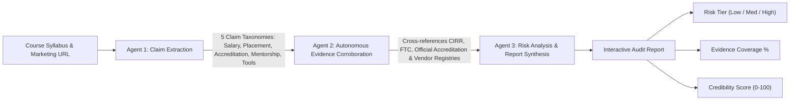

<div align="center">

# 🛡️ VeriCourse AI
### *Autonomous Educational Trust Intelligence & Multi-Agent Verification Platform*

[](https://github.com/2025csmdsaadahmed/VeriCourse_AI/actions)
[](https://github.com/2025csmdsaadahmed/VeriCourse_AI/actions)
[](https://www.docker.com/)
[](https://fastapi.tiangolo.com/)
[](https://react.dev/)
[](https://ai.google.dev/)
[](https://www.postgresql.org/)

<p align="center">
  <strong>Cross-examining online course claims, salary guarantees, and accreditation authenticity with autonomous AI agents before students invest their tuition.</strong>
</p>

[Explore Platform](#-key-features) • [Architecture](#-tri-agent-verification-pipeline) • [Meet the Team](#-meet-the-team) • [Quick Start](#-quick-start) • [Lab Experiments](#-academic-curriculum-experiments-114)

---

</div>

## 📖 What is VeriCourse AI?

Online educational marketing suffers from extreme information asymmetry: predatory bootcamps and unaccredited online courses lure learners with claims like *"100% Guaranteed Job Placement within 60 days"* and *"Starting salary of $140,000 or full refund"*.

**VeriCourse AI** solves this problem by acting as an independent, algorithmic credibility auditor. Users submit a course syllabus, and our **Tri-Agent AI Engine** autonomously parses claims, verifies them against regulatory bodies and industry benchmarks, calculates an empirical evidence score, and produces an actionable transparency audit report alongside real crowdsourced student outcome experiences.

---

## 👥 Meet the Team

| Team Member | Role & Ownership | Core Responsibilities |
| :--- | :--- | :--- |
| **Md Saad Ahmed** | **Lead Backend & AI Multi-Agent Architect** | • Designed & orchestrated the 3-Agent verification pipeline with Google Gemini.<br>• Built core FastAPI REST APIs, secure JWT auth (7-day extended lifecycle), and SSRF validation.<br>• Authored autonomous evidence discovery & scoring logic. |
| **Mani Shankar Dubey** | **Backend Engineering & Applied Research** | • Implemented PostgreSQL relational database models & schema migrations.<br>• Conducted research on educational compliance standards (CIRR, FTC earnings guidelines, ISO/IEC 17024).<br>• Designed benchmark databases and claim classification taxonomies. |
| **Mallikarjun K S** | **Lead Frontend Architect** | • Built responsive React 18 / TypeScript single-page application.<br>• Developed Course Submission, Evidence Report views, and live Website Favicon integrations.<br>• Engineered modern 2-column SaaS Authentication flows and interactive query chat widgets. |
| **Manasa M** | **Full-Stack & Backend Integration** | • Developed student experience feedback submission APIs and dashboard aggregations.<br>• Built course discovery filters, search endpoints, and comparison engines.<br>• Ensured end-to-end integration between client state and database services. |
| **Manurkar Chaitanya** | **DevOps & Cloud Infrastructure Lead** | • Engineered multi-stage production Dockerfiles (Python & Nginx/Node Alpine).<br>• Configured Docker Compose multi-container networking (db, backend, frontend).<br>• Automated GitHub Actions CI/CD pipelines with linting, testing, and container verification. |

---

## 🤖 Tri-Agent Verification Pipeline



1. **Agent 1: Claim Extraction**: Scans raw marketing descriptions, syllabus text, or web pages, breaking unstructured prose into verifiable atomic claims with categories (Placement, Salary, Accreditation, Faculty, Curriculum).
2. **Agent 2: Autonomous Evidence Corroboration**: Without requiring manual user links, autonomously queries authoritative standards (FTC guidelines, CIRR outcome reports, AWS/Linux Foundation registries) and assesses source credibility.
3. **Agent 3: Risk Analysis & Synthesis**: Evaluates corroborated evidence vs. marketing promises, flags high-risk or conflicting claims, calculates an overall trust score, and compiles a comprehensive, readable audit report.

---

## 🚀 Key Features

* **Instant AI Course Investigation**: Real-time multi-agent audit with live execution indicators and dynamic external evidence badges.
* **Autonomous Evidence Gathering**: Automatic discovery of regulatory benchmarks from FTC, CIRR, BLS, and accredited certification directories.
* **Side-by-Side Course Comparison**: Directly compare tuition costs, placement veracity, syllabus transparency, and risk ratings between multiple providers.
* **Student Reality Reviews**: Crowdsourced, authenticated reviews capturing real student job placement outcomes and refund experiences.
* **Pre-Auth AI Assistant**: Interactive chatbot on the Sign-In page answering questions on system architecture, tools used, and problem statement.
* **Automated CI/CD & Dockerization**: Zero-friction local and cloud deployments with multi-stage Docker builds and continuous integration.

---

## 🛠️ Technology Stack

| Domain | Technologies |
| :--- | :--- |
| **Frontend UI/UX** | React 18, TypeScript, Tailwind CSS, Lucide Icons, Framer Motion, Three.js, Vite |
| **Backend REST API** | Python 3.10, FastAPI, Pydantic V2, Uvicorn, Passlib (Argon2), PyJWT, SQLAlchemy 2.0 |
| **AI / Machine Learning** | Google Gemini API (`gemini-3.5-flash-lite`), Automated Exponential Retry Resilience |
| **Database & Cache** | PostgreSQL 16 (AlloyDB & Cloud SQL compatible), Alembic Migrations |
| **DevOps & Containers** | Docker (Multi-stage), Docker Compose, Nginx (Reverse Proxy & SPA routing), GitHub Actions |

---

## 🐳 Quick Start with Docker (Recommended)

Run the entire platform (Database + Backend + Frontend) in one command:

```bash
docker compose up -d --build
```

Access services:
* 🌐 **Frontend Web App**: [http://localhost:3000](http://localhost:3000)
* 📖 **Backend Swagger API Docs**: [http://localhost:8000/docs](http://localhost:8000/docs)
* 🗄️ **Database (PostgreSQL)**: `localhost:5433` (User: `vericourse_user`, DB: `vericourse_db`)

---

## 💻 Manual Local Development

### 1. Backend (FastAPI)
```bash
cd backend
python3 -m venv .venv
source .venv/bin/activate    # On Windows: .venv\Scripts\activate
pip install -r requirements.txt
python create_tables.py
uvicorn app.main:app --reload --port 8000
```

### 2. Frontend (React + Vite)
```bash
cd frontend
npm install
npm run dev
```
Open [http://localhost:5173](http://localhost:5173) in your browser.

---

## 📚 Academic Curriculum Experiments (1–14)

VeriCourse AI satisfies all 14 continuous software delivery and development experiments:

| Experiment | Title & Focus | Documentation |
| :---: | :--- | :--- |
| **1–3** | Git Version Control, Branching Strategy & Merge Workflows | [`docs/GIT_WORKFLOW_AND_COLLABORATION.md`](./docs/GIT_WORKFLOW_AND_COLLABORATION.md) |
| **4–5** | Team Collaboration, Feature Isolation & Conflict Resolution | [`docs/GIT_WORKFLOW_AND_COLLABORATION.md`](./docs/GIT_WORKFLOW_AND_COLLABORATION.md) |
| **6–7** | GitHub Actions CI/CD Pipeline Automation & Testing | [`docs/GITHUB_ACTIONS_CI.md`](./docs/GITHUB_ACTIONS_CI.md) |
| **8–9** | Dockerization & Multi-Stage Production Container Images | [`docs/DOCKER_AND_CONTAINERIZATION.md`](./docs/DOCKER_AND_CONTAINERIZATION.md) |
| **10–11** | Multi-Container Orchestration with Docker Compose | [`docs/DOCKER_AND_CONTAINERIZATION.md`](./docs/DOCKER_AND_CONTAINERIZATION.md) |
| **12** | UX Research, User Personas & Wireframe Prototypes | [`docs/UX_RESEARCH_AND_PERSONAS.md`](./docs/UX_RESEARCH_AND_PERSONAS.md) |
| **13** | Design System, Color Philosophy & Figma Specifications | [`docs/FIGMA_PROTOTYPE_AND_DESIGN_SYSTEM.md`](./docs/FIGMA_PROTOTYPE_AND_DESIGN_SYSTEM.md) |
| **14** | Capstone Project Final Architecture & Defense Documentation | [`docs/CDD_FINAL_PROJECT_REPORT.md`](./docs/CDD_FINAL_PROJECT_REPORT.md) |

---

<div align="center">
  <sub>Built with academic rigor and passion by the VeriCourse AI Engineering Team • 2026</sub>
</div>
