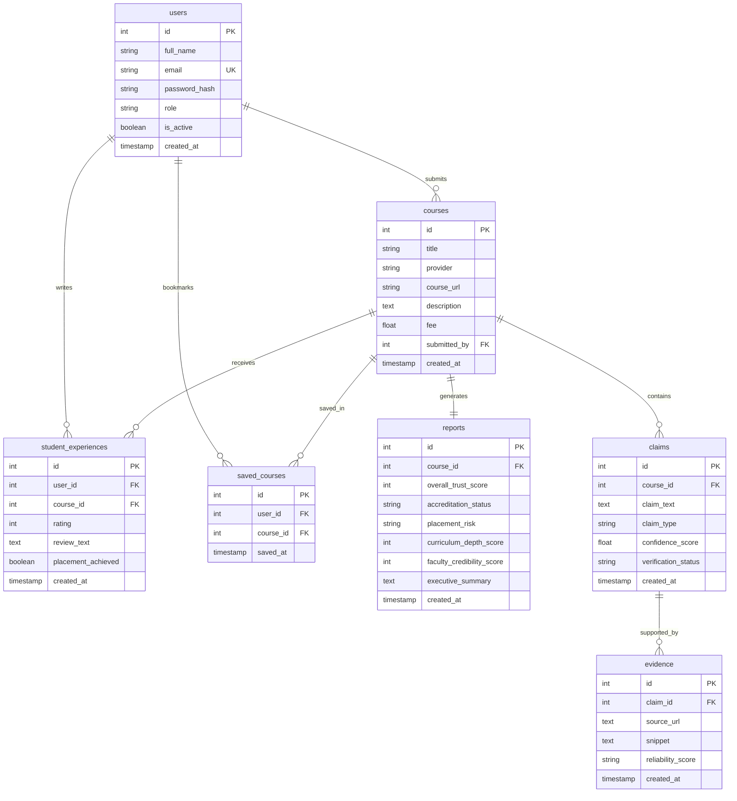

# VeriCourse AI — Database Schema Documentation
**Database Engine:** PostgreSQL 16  
**Object-Relational Mapping:** SQLAlchemy 2.0  
**Migration Engine:** Alembic

---

## 1. Entity-Relationship Overview

---

## 2. Table Specifications & Constraints

### 2.1 `users`
Stores user authentication profiles, security credentials, and access roles.
- `id` (SERIAL PRIMARY KEY)
- `full_name` (VARCHAR(100), NOT NULL)
- `email` (VARCHAR(150), UNIQUE, INDEXED, NOT NULL)
- `password_hash` (VARCHAR(255), NOT NULL)
- `role` (VARCHAR(20), DEFAULT 'student')
- `is_active` (BOOLEAN, DEFAULT TRUE)
- `created_at` (TIMESTAMP WITH TIME ZONE, DEFAULT NOW())

### 2.2 `courses`
Stores online courses submitted by users or discovered via automated crawlers.
- `id` (SERIAL PRIMARY KEY)
- `title` (VARCHAR(255), NOT NULL)
- `provider` (VARCHAR(150), NOT NULL)
- `course_url` (VARCHAR(500), NOT NULL)
- `description` (TEXT)
- `fee` (FLOAT, DEFAULT 0.0)
- `submitted_by` (INTEGER, FOREIGN KEY -> `users.id`)
- `created_at` (TIMESTAMP WITH TIME ZONE, DEFAULT NOW())

### 2.3 `claims`
Extracted individual claims parsed by the **Claim Extraction Agent**.
- `id` (SERIAL PRIMARY KEY)
- `course_id` (INTEGER, FOREIGN KEY -> `courses.id`, ON DELETE CASCADE)
- `claim_text` (TEXT, NOT NULL)
- `claim_type` (VARCHAR(50)) — *Curriculum, Accreditation, Placement, Faculty, Pricing*
- `confidence_score` (FLOAT, DEFAULT 0.0)
- `verification_status` (VARCHAR(30), DEFAULT 'pending')
- `created_at` (TIMESTAMP WITH TIME ZONE, DEFAULT NOW())

### 2.4 `evidence`
Corroborating or refuting evidence retrieved by the **Evidence Verification Agent**.
- `id` (SERIAL PRIMARY KEY)
- `claim_id` (INTEGER, FOREIGN KEY -> `claims.id`, ON DELETE CASCADE)
- `source_url` (TEXT)
- `snippet` (TEXT)
- `reliability_score` (FLOAT)
- `created_at` (TIMESTAMP WITH TIME ZONE, DEFAULT NOW())

### 2.5 `reports`
Composite evaluation generated by the **Risk Analysis Agent** & **Verification Orchestrator**.
- `id` (SERIAL PRIMARY KEY)
- `course_id` (INTEGER, FOREIGN KEY -> `courses.id`, UNIQUE, ON DELETE CASCADE)
- `overall_trust_score` (INTEGER, CHECK (overall_trust_score BETWEEN 0 AND 100))
- `accreditation_status` (VARCHAR(50))
- `placement_risk` (VARCHAR(30))
- `curriculum_depth_score` (INTEGER)
- `faculty_credibility_score` (INTEGER)
- `executive_summary` (TEXT)
- `created_at` (TIMESTAMP WITH TIME ZONE, DEFAULT NOW())
