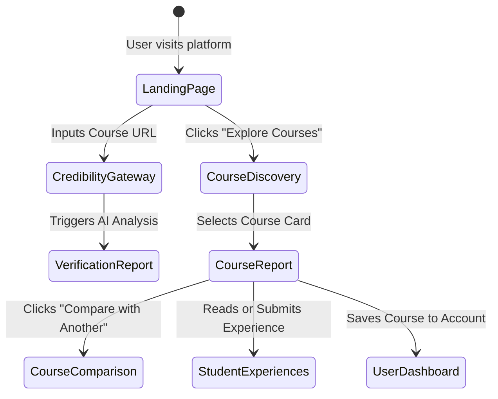

# Figma Prototype & Design System Specification
**Project:** VeriCourse AI  
**Academic Reference:** CDD Lab Manual (Experiment 13)  
**Implementation Mapping:** `frontend/tailwind.config.js`, `frontend/src/index.css`

---

## 1. Design System Philosophy & Aesthetic Direction

**VeriCourse AI** uses a dark, immersive theme designed to project security, high-tech credibility, and academic precision. The visual language blends:
- Deep obsidian and charcoal backdrops for reduced visual fatigue.
- Emerald and mint accents representing verification, validity, and truth.
- Radiant amber/gold accents representing premium academic achievements and gateway portals.
- Frosted glassmorphism (`backdrop-blur`) for elevated hierarchical depth.

---

## 2. Design Tokens (Experiment 13)

### 2.1 Color Palette
```
┌─────────────────┬────────────────┬────────────────────────────────────┐
│ Token Name      │ Hex Code       │ Semantic Purpose                   │
├─────────────────┼────────────────┼────────────────────────────────────┤
│ primary-500     │ #10B981        │ Brand verification emerald         │
│ primary-600     │ #059669        │ Active button / hover states       │
│ primary-400     │ #34D399        │ Highlighting & subtle glows        │
│ gold-500        │ #F59E0B        │ Credibility gateway, stars, badges │
│ gold-600        │ #D97706        │ High-contrast gold borders         │
│ background-dark │ #0B0F19        │ Primary application canvas         │
│ card-dark       │ #111827        │ Elevated card & container surface  │
│ border-dark     │ #1F2937        │ Subtle separation borders          │
│ text-main       │ #F9FAFB        │ Primary high-contrast text         │
│ text-muted      │ #9CA3AF        │ Secondary labels and metadata      │
│ danger-red      │ #EF4444        │ Flagged claims, high risk warnings │
└─────────────────┴────────────────┴────────────────────────────────────┘
```

### 2.2 Typography Scale
Font Family: **Inter** / **Plus Jakarta Sans** (sans-serif)
- **Display 1**: 48px / Line Height 1.1 / Bold (Landing Page Hero)
- **Heading 1**: 32px / Line Height 1.2 / Semi-Bold (Page Titles)
- **Heading 2**: 24px / Line Height 1.3 / Semi-Bold (Card Titles, Section Headers)
- **Body Large**: 18px / Line Height 1.5 / Regular (Lead Paragraphs)
- **Body Regular**: 14px / Line Height 1.5 / Regular (General Text, Form Inputs)
- **Caption**: 12px / Line Height 1.4 / Medium (Status Tags, Footnotes)

### 2.3 Spacing & Elevation Tokens
- **Grid Baseline**: 4px / 8px incremental scale (`p-2`, `p-4`, `p-6`, `p-8`).
- **Border Radii**: Small (`rounded-md`, 6px), Standard (`rounded-xl`, 12px), Pill (`rounded-full`, 9999px).
- **Glassmorphism**: `background: rgba(17, 24, 39, 0.7); backdrop-filter: blur(12px); border: 1px solid rgba(255, 255, 255, 0.08);`.

---

## 3. Reusable Component Specifications (Figma Library)

### 3.1 Primary Verification Button
- **Default State**: Solid emerald background (`#10B981`), white text, bold, rounded-xl, subtle drop shadow.
- **Hover State**: Elevates by 2px, emerald darkens to `#059669`, inner ring transition.
- **Loading State**: Displays rotating SVG spinner with text *"Analyzing claims..."*, button disabled.

### 3.2 Credibility Trust Score Gauge
- **Circle / Radial Meter**: Displays numerical score 0–100.
  - Score 80–100: **Emerald Green** (High Trust / Verified).
  - Score 60–79: **Amber Yellow** (Moderate Risk / Caution).
  - Score 0–59: **Crimson Red** (High Risk / Fraud Alert).

### 3.3 Extracted Claim Card
- **Layout**: Flex row with claim statement on left and verification badge on right.
- **Variants**:
  - `Verified`: Emerald checkmark badge, source link pills.
  - `Partially True`: Amber warning badge, discrepancy note.
  - `Unsubstantiated`: Red caution badge, highlighted risk score.

---

## 4. Interactive Prototype Flow (Figma)



---

## 5. Accessibility (WCAG 2.1 AA) Compliance
1. **Color Contrast**: All primary text (`#F9FAFB`) on dark surfaces (`#0B0F19`) exceeds a 7:1 contrast ratio (exceeding AAA standard).
2. **Focus Indicators**: Explicit emerald focus rings (`ring-2 ring-emerald-500`) on all interactive inputs and buttons.
3. **Screen Reader Landmarks**: Semantic HTML (`<main>`, `<nav>`, `<section>`, `<article>`) across all views.
