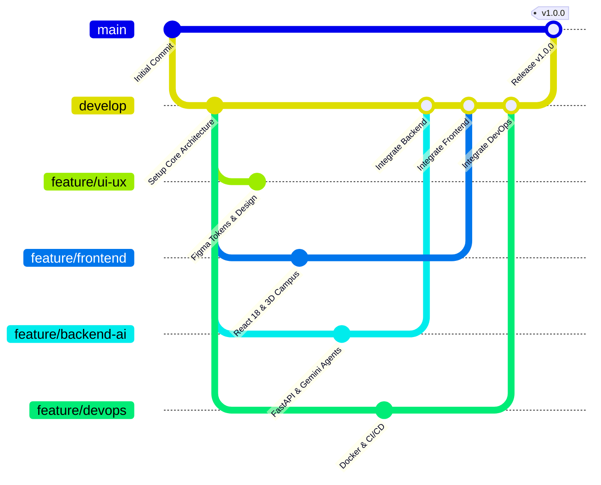

# Git Workflow and Collaboration Guide
**Project:** VeriCourse AI  
**Academic Reference:** CDD Lab Manual (Experiments 1–5)  
**Repository Branch Model:** GitFlow with Feature Branching

---

## 1. Overview and Objectives

This document establishes the official collaborative version control and software delivery workflow for **VeriCourse AI**, directly fulfilling the requirements of **Experiments 1 through 5** of the Collaborative Development and DevOps (CDD) curriculum:

- **Experiment 1:** Git Installation, Global Configuration, Staging, and Commit History.
- **Experiment 2:** Remote Operations (`origin`), Fetching, Pulling, Pushing, and Repository Synchronization.
- **Experiment 3:** Branching, Switching, Merging, Rebasing, and Merge Conflict Resolution.
- **Experiment 4:** GitHub Collaboration via Issues, Pull Requests, Code Reviews, and Forks.
- **Experiment 5:** Team Collaboration Strategy, Work Distribution, and Quality Assurance Gates.

---

## 2. Git Installation, Configuration & Basic Commands (Experiment 1)

### 2.1 Installation Verification
To verify Git is installed and check the version:
```bash
git --version
# Expected: git version 2.x or higher
```

### 2.2 Global Identity Configuration
Each developer configures their identity to ensure accurate attribution across all commits:
```bash
git config --global user.name "Saad Ahmed"
git config --global user.email "student@university.edu"
git config --global init.defaultBranch main
git config --global pull.rebase false
```
To verify active configuration:
```bash
git config --list --show-origin
```

### 2.3 Repository Initialization & Workspace Status
VeriCourse AI was initialized at the project root:
```bash
# Check repository working tree and index status
git status
```
Output:
```text
On branch feature/backend-ai
Your branch is ahead of 'origin/feature/backend-ai' by 1 commit.
nothing to commit, working tree clean
```

### 2.4 Staging and Committing Changes
Standard staging and atomic commit pattern:
```bash
# Stage specific modified files
git add path/to/file.py

# Or stage all tracked/untracked changes
git add .

# Create commit with descriptive, imperative message
git commit -m "feat(backend): implement multi-agent verification orchestrator"
```

### 2.5 Inspecting Commit History
```bash
# Formatted one-line history with branch decoration
git log --oneline --graph --decorate -n 10
```
Key project commit hash reference:
- `bcb7584` — `feat: complete VeriCourse AI full-stack platform, 3D credibility gateway, multi-agent verification pipeline, and brand identity`

---

## 3. Remote Operations & Repository Synchronization (Experiment 2)

### 3.1 Remote Configuration
The repository tracks the central remote repository named `origin`:
```bash
git remote -v
```
Sample configuration:
```text
origin  https://github.com/organization/VeriCourse_AI.git (fetch)
origin  https://github.com/organization/VeriCourse_AI.git (push)
```

### 3.2 Synchronizing Remote Changes
Before beginning work on any feature branch, fetch and integrate the latest upstream changes:
```bash
# Fetch all remote branches and metadata without modifying the working tree
git fetch origin

# Inspect differences between local branch and remote tracking branch
git log HEAD..origin/feature/backend-ai --oneline

# Pull upstream changes into current branch
git pull origin feature/backend-ai
```

### 3.3 Publishing Commits
To push commits from a local feature branch to the remote repository:
```bash
# Push with upstream tracking set on first push
git push -u origin feature/backend-ai
```

> [!IMPORTANT]
> In accordance with project safety guidelines, commits are never force-pushed (`git push -f`) and work is reviewed before remote publication.

---

## 4. Branching, Merging, Rebasing & Conflict Resolution (Experiment 3)

### 4.1 Branch Structure in VeriCourse AI
The project uses dedicated branches for distinct subsystems:



Current local and tracking branches:
- `main` — Production-ready code; tagged releases only.
- `develop` — Integration branch for tested features.
- `feature/backend-ai` — FastAPI services, Gemini agent pipeline, PostgreSQL ORM.
- `feature/frontend` — React SPA, Vite, Three.js 3D Campus, Tailwind CSS.
- `feature/devops` — Dockerfiles, Docker Compose, GitHub Actions CI.
- `feature/ui-ux` — Design tokens, component specs, Figma prototypes.
- `feature/research` — Educational verification datasets and claim taxonomy.

### 4.2 Branch Operations
```bash
# List all branches
git branch -a

# Create and checkout a new branch
git checkout -b feature/user-profile-settings

# Switch between existing branches
git checkout develop
git checkout feature/backend-ai
```

### 4.3 Merging vs. Rebasing
- **Merge (`git merge <branch>`)**: Preserves complete historical context and commit timestamps. Creates a merge commit representing integration points.
- **Rebase (`git rebase develop`)**: Replays branch commits on top of the latest target branch base, creating a linear history. Recommended for feature branch cleanups *prior* to opening a Pull Request.

### 4.4 Merge Conflict Resolution Protocol
When concurrent changes occur on the same lines of code in different branches:

1. **Triggering Scenario**: Branch A and Branch B both modify `backend/app/core/config.py`.
2. **Detection**:
   ```bash
   git merge feature/new-settings
   # Auto-merging backend/app/core/config.py
   # CONFLICT (content): Merge conflict in backend/app/core/config.py
   # Automatic merge failed; fix conflicts and then commit the result.
   ```
3. **Inspection**:
   ```bash
   git status
   # both modified: backend/app/core/config.py
   ```
4. **Conflict Markers Anatomy**:
   ```python
   <<<<<<< HEAD
   APP_VERSION = "1.0.0"
   ENVIRONMENT = "production"
   =======
   APP_VERSION = "1.1.0"
   ENVIRONMENT = "staging"
   >>>>>>> feature/new-settings
   ```
5. **Resolution Process**:
   - Manually edit the file to select the correct combined logic.
   - Remove all marker lines (`<<<<<<<`, `=======`, `>>>>>>>`).
   - Run tests to verify zero regressions.
6. **Finalizing the Resolution**:
   ```bash
   git add backend/app/core/config.py
   git commit -m "fix(config): resolve merge conflict between develop and feature/new-settings"
   ```

---

## 5. GitHub Collaboration & Code Review Workflow (Experiment 4)

### 5.1 Issue Tracking
All functional requirements, bugs, and enhancements are tracked as GitHub Issues using structured templates:
- **Bug Report Template** (`.github/ISSUE_TEMPLATE/bug_report.md`): Environment, steps to reproduce, expected vs actual behavior, logs.
- **Feature Request Template** (`.github/ISSUE_TEMPLATE/feature_request.md`): User story, proposed solution, architectural impact.

### 5.2 Pull Request (PR) Lifecycle
1. Branch created from `develop` (`feature/<feature-name>`).
2. Changes implemented, formatted, and locally tested.
3. Branch pushed to GitHub remote.
4. Pull Request opened against `develop` using `.github/pull_request_template.md`.
5. Automated CI checks run (backend pytest + frontend Vite build).
6. Peer code review conducted; minimum 1 approval required.
7. Squash-and-merge or merge commit executed upon approval.

### 5.3 Code Review Checklist
Reviewers evaluate:
- [ ] Code adheres to project design patterns and architectural layers.
- [ ] No hardcoded secrets or environment variables.
- [ ] Unit and integration tests pass without warnings.
- [ ] API routes follow REST conventions and return Pydantic schemas.
- [ ] UI changes preserve responsiveness and dark theme aesthetics.

---

## 6. Team Collaboration & Branch Governance (Experiment 5)

### 6.1 Team Role Matrix

| Role | Primary Responsibility | Target Branches | Review Scope |
| :--- | :--- | :--- | :--- |
| **Backend Engineer** | FastAPI routes, SQLAlchemy models, Gemini agents, DB migrations | `feature/backend-ai` | API design, query efficiency, AI latency |
| **Frontend Engineer** | React 18 UI, 3D Campus, state management, API integration | `feature/frontend` | Component hierarchy, responsive styling, accessibility |
| **DevOps Specialist** | Docker multi-container setup, GitHub Actions CI, deployment | `feature/devops` | Docker layer caching, CI speed, security |
| **UI/UX Designer** | Personas, user journeys, Figma tokens, interactive prototypes | `feature/ui-ux` | Visual consistency, usability heuristics |
| **Project Lead** | Release coordination, PR approvals, capstone integration | `develop`, `main` | End-to-end system cohesion |

### 6.2 Branch Protection Rules
For academic and enterprise compliance, `main` and `develop` enforce:
- Required PR reviews before merging (1 approving reviewer).
- Required status checks to pass before merging (`backend-ci`, `frontend-ci`).
- Dismiss stale pull request approvals when new commits are pushed.
- Prohibit force pushes and branch deletions.
