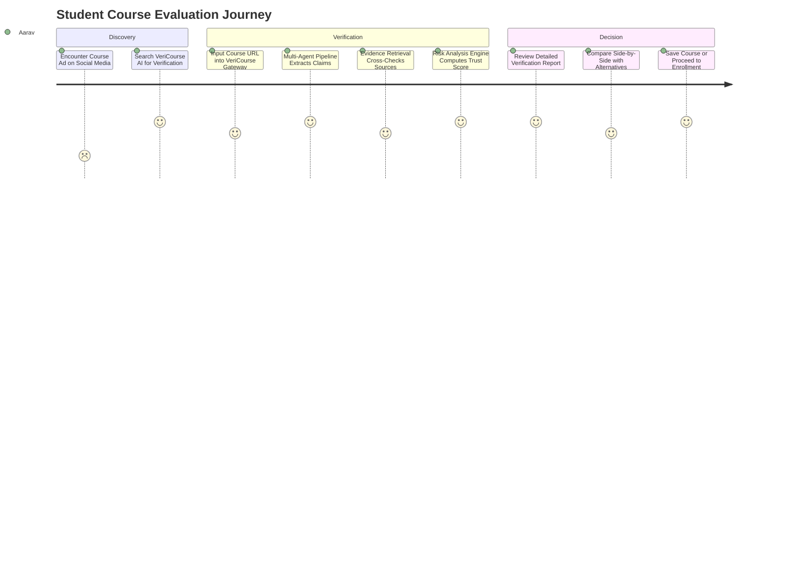

# UX Research, Personas, and Wireframes
**Project:** VeriCourse AI  
**Academic Reference:** CDD Lab Manual (Experiment 12)  
**System Scope:** EdTech Verification, Trust Scoring & Credibility Platform

---

## 1. Executive Summary & Research Methodology

The rapid expansion of the online education sector has led to an explosion of unsubstantiated placement promises, unaccredited certifications, and inflated curriculum claims. **VeriCourse AI** addresses this crisis through continuous, automated AI-driven verification.

### 1.1 Problem Statement
- Students invest significant financial resources and time in online courses with misleading marketing ("100% Guaranteed Placement", "Recognized by Top Tech Companies").
- No standardized, real-time trust intelligence engine exists to cross-examine claims against real-world regulatory databases, curriculum depth standards, and verified student outcomes.

### 1.2 Target Audience Segments
1. **Undergraduate Students & Career Changers**: Seeking trustworthy credentials to transition into technical industries.
2. **Academic Advisors & Educational Auditors**: Assessing program legitimacy and safeguarding student interests.

---

## 2. User Personas (Experiment 12)

### Persona 1: The Aspiring Career Switcher
```
┌────────────────────────────────────────────────────────┐
│ PERSONA: Aarav Sharma                                  │
│ Age: 22 | Role: Final Year Computer Science Undergrad │
│ Technical Proficiency: Intermediate | Location: Urban  │
├────────────────────────────────────────────────────────┤
│ GOALS:                                                 │
│ • Identify high-quality AI/Data Science bootcamps.     │
│ • Verify placement guarantee legitimacy before paying. │
│ • Review authentic, tamper-free student experiences.   │
├────────────────────────────────────────────────────────┤
│ PAIN POINTS:                                           │
│ • Aggressive sales calls making unsubstantiated claims.│
│ • Difficulty distinguishing between genuine accredit-  │
│   ations and private marketing certificates.           │
│ • Lack of comparative side-by-side claim audits.       │
├────────────────────────────────────────────────────────┤
│ "I cannot afford to waste six months and \$1,500 on a    │
│ course that recruiters dismiss as a scam."             │
└────────────────────────────────────────────────────────┘
```

### Persona 2: The EdTech Compliance Auditor
```
┌────────────────────────────────────────────────────────┐
│ PERSONA: Dr. Meera Sen                                 │
│ Age: 41 | Role: University Career Development Director │
│ Technical Proficiency: Advanced | Location: Bangalore  │
├────────────────────────────────────────────────────────┤
│ GOALS:                                                 │
│ • Audit external course providers recommended to       │
│   university students.                                 │
│ • Access transparent risk breakdowns (Syllabus,        │
│   Pricing, Placement, Faculty).                        │
│ • Flag high-risk providers across campus networks.     │
├────────────────────────────────────────────────────────┤
│ PAIN POINTS:                                           │
│ • Manual verification takes dozens of hours per course.│
│ • Lack of centralized evidence trails for disputed     │
│   course marketing materials.                          │
└────────────────────────────────────────────────────────┘
```

---

## 3. User Journey Mapping



---

## 4. Low-Fidelity UI Wireframes

### 4.1 Landing Page & Credibility Gateway Wireframe
```
┌────────────────────────────────────────────────────────────────────────┐
│ [Logo] VeriCourse AI        Discovery   Compare   Experiences  [Sign In]│
├────────────────────────────────────────────────────────────────────────┤
│                                                                        │
│                THE CREDIBILITY GATEWAY FOR EDUCATION                   │
│         Verify Course Claims, Accreditation & Placement Promises        │
│                                                                        │
│   ┌────────────────────────────────────────────────────────┬───────┐   │
│   │  Enter Course URL (e.g. https://provider.com/course)   │VERIFY │   │
│   └────────────────────────────────────────────────────────┴───────┘   │
│                                                                        │
│       [ 3D Interactive Campus Canvas - Three.js Visual Scene ]         │
│                                                                        │
├────────────────────────────────────────────────────────────────────────┤
│  [Stat: 98.4% Accuracy]     [Stat: 14k+ Claims Audited]  [3 AI Agents] │
└────────────────────────────────────────────────────────────────────────┘
```

### 4.2 Verification Report & Trust Score Breakdown Wireframe
```
┌────────────────────────────────────────────────────────────────────────┐
│ [← Back to Discover]  Python for Data Science (NPTEL)   [Save Course]  │
├────────────────────────────────────────────────────────────────────────┤
│  OVERALL TRUST SCORE: 88 / 100   [STATUS: HIGH CREDIBILITY]            │
│  Accreditation: Verified | Placement Claim: Low Risk | Fee: ₹1,000    │
├───────────────────────────────────┬────────────────────────────────────┤
│ EXTRACTED CLAIMS & EVIDENCE       │ RISK BREAKDOWN MATRIX              │
│ • "Government of India approved"  │ • Curriculum Depth:  [92%] Low     │
│   Status: VERIFIED (NPTEL / MoE)  │ • Placement Reality: [85%] Low     │
│ • "100% Placement Guaranteed"     │ • Faculty Cred:      [95%] Low     │
│   Status: UNFOUNDED               │ • Fee Transparency:  [80%] Moderate│
├───────────────────────────────────┴────────────────────────────────────┤
│ VERIFIED STUDENT EXPERIENCES & RATINGS                                 │
│ ★★★★★ "Rigorous assignments, difficult exams, authentic certificate." │
└────────────────────────────────────────────────────────────────────────┘
```

### 4.3 Course Comparison Screen Wireframe
```
┌────────────────────────────────────────────────────────────────────────┐
│ COURSE COMPARISON MATRIX                                  [+ Add Course│
├──────────────────────────────┬─────────────────────────────┬───────────┤
│ METRIC                       │ COURSE A: NPTEL Data Science│ COURSE B: │
├──────────────────────────────┼─────────────────────────────┼───────────┤
│ Trust Score                  │ 88 / 100                    │ 64 / 100  │
│ Accreditation Verified       │ Yes (MoE Approved)          │ No        │
│ Placement Guarantee Claim    │ Not Claimed                 │ Claimed   │
│ Placement Evidence Found     │ N/A                         │ False     │
│ Tuition Fee                  │ ₹1,000                      │ ₹45,000   │
│ Risk Assessment              │ Very Low Risk               │ High Risk │
└──────────────────────────────┴─────────────────────────────┴───────────┘
```
